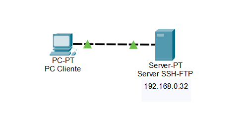
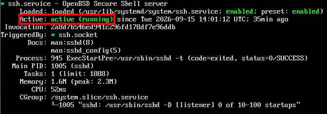
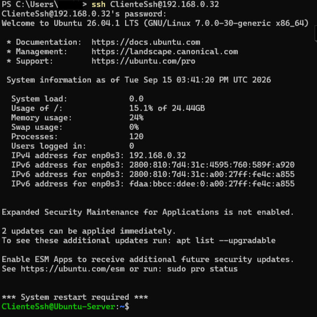
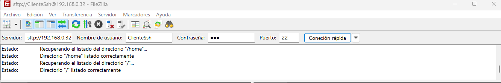
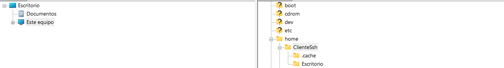

# Instalacion y montaje de servidor SSH y FTP entre Windows 11 y Ubuntu Server

### Descripción:
Montaremos un servidor SSH y FTP entre W11 y Ubuntu Server que permita control remoto de nuestro terminal servidor a partir de nuestro terminal con W11.

### Objetivo: 
Montar de forma simple y prototipada un servidor SSH y FTP con el fin de aprender a implementar estos servicios.

### Herramientas:
* Una maquina virtual o no, iniciada con Oracle VBox con un SO Ubuntu server.
* Una maquina virtual o no, iniciada con W11
* Filezilla descargado e instalado en W11:
https://filezilla-project.org
---
# Escenario:

## Creando y configurando Ubuntu Server en Oracle VMBox
1) Descargar imagen ISO de Ubuntu Server:
https://ubuntu.com/download/server

2) Crear nueva maquina virtual. En VMBox seleccionar "Nueva", seleccionar ubicación de instalacion y seleccionar nombre de maquina. En "Imagen ISO" colocar la imagen ISO del Ubuntu Server.
3) Crear nombre de usuario y colocar contraseña que usaremos para iniciar sesión en la maquina virtual. 
4) En la sección de "Hardware" colocaremos 2GB de memoria RAM. 1 o 2 nucleos de CPU.
5) En "Disco Duro" colocaremos 80GB de almacenamiento, aunque puede funcionar tranquilamente con 20 o 30GB.
6) Una vez creada la VM, iremos a configuración de red en la interfaz de VMBox. En "Nombre" seleccionaremos la interfaz de red que usaremos. y en "Conectado A" pondremos en "adaptador puente" para que la VM tenga su propia IPv4 

## Configuración de W11
* Entramos a "Caracteristicas Opcionales" y agregaremos el servicio "Cliente Open SSH" para luego controlar remotamente el servidor SSH
---
## Topología de red
### Ya que este escenario esta pensado a modo de prueba, se va a usar DHCP como metodo de asignacion de IPv4 para nuestro OS W11
* La red quedaria montada fisicamente como una red P2P, pero lógicamente funciona como una cliente-servidor



## Configuración de SO Ubuntu Server
Una vez iniciado sesión en tu usuario de la VM, vamos a instalar el servicio OpenSSH

### Servicio SSH:

* Crear super usuario (sudo) para nuestro cliente W11 (opcional)
  * Crear usuario y dar permisos sudo


  ```
   sudo adduser <Nombre_de_usuario>

   sudo usermod -aG sudo <Nombre_de_usuario>
  ```
 
 comando -aG indica que se tiene que añadir al grupo de usuarios sudo.

* Ejecutamos ``sudo apt install openssh-server`` para instalar OpenSSH.

* Iniciamos servicio: ``sudo systemctl start sshd`` y 

* Verificamos que se haya instalado e iniciado: ``sudo systemctl status sshd``.


(Si queremos que nuestro servidor inicie el servicio cuando prendamos el servidor, colocamos en el terminal: ``sudo systemctl enable sshd``)

### Servicio FTP
Ya que solo tenemos un terminal, para simplificar la gestion de usuarios, tendremos uso de FTP anonimo

* Instalar paquete vsftpd: ``sudo apt install vsftpd``
* Iremos al directorio etc/ y en el archivo de texto vstpfd.conf usamos ``nano vsftpd.conf`` y colocamos anonymous_enable=YES
* En el mismo archivo vsftpd.conf descomentamos ``anon_upload_enable=YES`` para permitir que usuarios anonimos suban archivos con el servicio (No recomendado para servidores que son accesibles directamente al internet por alto riesgo de seguridad)
* Reiniciamos servicio: ``sudo systemctl restart vsftp``
* Para ver si el servicio funciona usamos ``sudo systemctl status vsftpd.service``
* Para que el servicio arranque automaticamente al encender el equipo usamos ``uso systemctl enable vsftpd.service``
 
 
 
 ### Luego de configurar el servidor, tenemos un espacio donde:
 * Tenemos un Usuario principal para movernos dentro del servidor de forma local.
 * Tenemos un usuario *sudo* para movernos dentro del servidor de forma remota (Usuario usuado: ClienteSsh)
--- 

## Uso de servicios SSH y FTP desde W11
En este entorno, se va a usar la IPv4 local 192.168.0.32 y el usuario ClienteSsh
### Para usar SSH:
* Abrimos Powershell de windows y colocamos ``ssh ClienteSsh@192.168.0.32`` y colocamos la contraseña que le designamos.

El terminal de Powershell mostrará el acceso exitoso a nuestro servidor SSH. A partir de este momento, tomamos control del usuario ClienteSsh, teniendo acceso root y teniendo total libertad de acceso al servidor.



### Para usar FTP: 
* Abrimos Filezilla en nuestro W11 y colocamos la dirección ip del servidor, Usuario a seleccionar, contraseña del usuario y colocamos el puerto 22 (sftp) y seleccionamos "conexión rápida"

* Una vez conectados al servidor, podemos ver que en la parte inferior de la interfaz podemos acceder a todos los directorios y archivos, donde ahora, podemos cargar o descargar archivos entre ambos terminales.
.
---
## Conclusión:
En esta practica podemos ver que con unos pocos comandos en nuestro ubuntu server, podemos implementar un servidor SSH y FTP de una forma basica. Si bien este servidor SSH y FTP esta montado sobre una maquina virtual, se podria replicar de igual manera en 2 equipos distintos. 

Esta infraestructura luego de crearla, podemos darnos cuenta que solo tenemos dos usuarios, el usuario sudo local y el remoto, sin ninguna oportunidad de albergar usuarios invitados ademas de tener una seguridad un tanto cuestionable. 


## Usuario invitado y seguridad (Opcional)
En un entorno con mas usuarios, es conveniente que no todos puedan acceder a los directorios y modificarlos, asi que crearemos un nuevo usuario "Invitado" y lo vamos a encerrar dentro de una carpeta dentro de su respectivo /home  (chroot jail). Esta configuracion aporta a la seguridad del servidor.

### Creacion usuario invitado
Para crear este usuario invitado usamos ``sudo adduser Invitado``. Colocamos contraseña simple que luego eliminaremos.

Eliminamos la contraseña de Invitado usuando ``sudo passwd -d Invitado`` para desactivar la contraseña del usuario.

### Limitar usuarios a sus directorios de inicio
* Necesitamos entrar a /etc/vsftpd.conf y descomentar la linea que dice ``chroot_local_user=YES``

* Descomentando la siguiente linea ``chroot_list_enable=YES`` podemos elegir que usuarios no estan limitados.
Tambien descomentar ``chroot_list_file=/etc/vsftpd.chroot_list`` para luego determinar usuarios sin limitaciones

* Crear el archivo de texto ``vsftpd.chroot_list`` en etc/

* En el archivo vsftpd.chroot_list colocamos un usuario por linea de los que queremos quitar limitaciones.

* Reiniciamos servicio ``sudo systemctl restart vsftpd.service``
